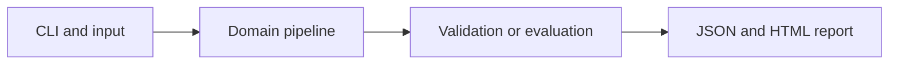

# Bounded Tool-Calling Agent

Execute a model-proposed tool plan through an allowlisted dispatcher with strict budgets and an audit trail.

**Category:** Agentic AI

**Execution:** Fixture replay by default; optional actual local-LLM generation. Live integration is implemented but not verified in this build.

## Run

```sh
python -m venv .venv
# Windows: .venv\Scripts\activate
# macOS/Linux: source .venv/bin/activate
python -m pip install -r requirements.txt
python app.py
python -m unittest discover -v
```

Open `results/report.html` after running. Python 3.10+ is required. Use `--help` for input and seed options.

For actual generation with a running Ollama installation and downloaded model:

```sh
python app.py --mode live --model YOUR_INSTALLED_MODEL
```

Model installation is separate and may require substantial memory. No silent fallback to fixtures is used. See [Ollama generation API](https://docs.ollama.com/api/generate) and [structured outputs](https://docs.ollama.com/capabilities/structured-outputs).

## Architecture



## Algorithm

Live mode requests a JSON plan from a local LLM; fixture mode replays a supplied plan. Validate a maximum of four calls, permitted tools and exact argument schemas. A calculator parses a restricted arithmetic AST; document search uses the local corpus.

## Evaluation

Test unknown tools, excessive call counts and unsafe calculator expressions. Execute the sample plan and record each tool observation. This is plan-then-execute orchestration, not an autonomous open-ended agent.

## Limitations

The planner is not live-tested in this build. Tool permission checks are real, but no browser, shell, network search or filesystem-writing tool is provided.

## Documentation

- [PDF project guide](PROJECT_GUIDE.pdf)
- [Editable guide](GUIDE.md)
- [Model and system card](MODEL_CARD.md)
- [Measured results](results/metrics.json)
- [Test output](TEST_RESULTS.txt)

## Extend it

Add observation-conditioned replanning, per-tool deadlines, human confirmation for side effects, budget accounting and adversarial plan evaluations.

AI-assisted educational project with synthetic data. Review, customize and explain your own contribution accurately. MIT license.
